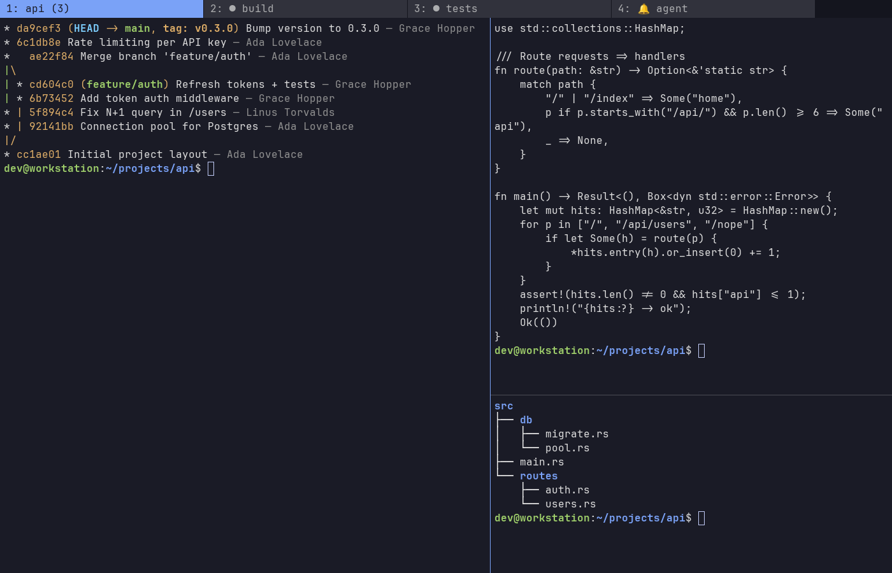
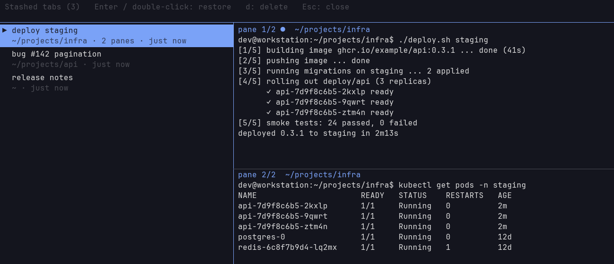
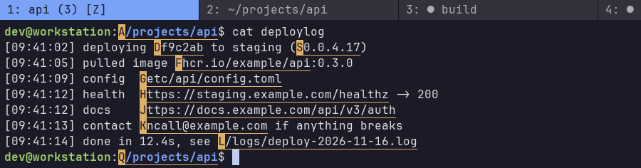
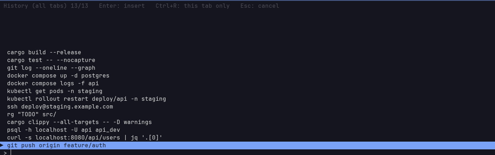
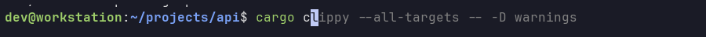
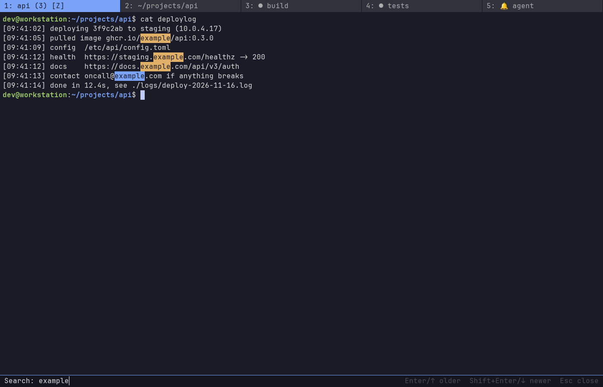
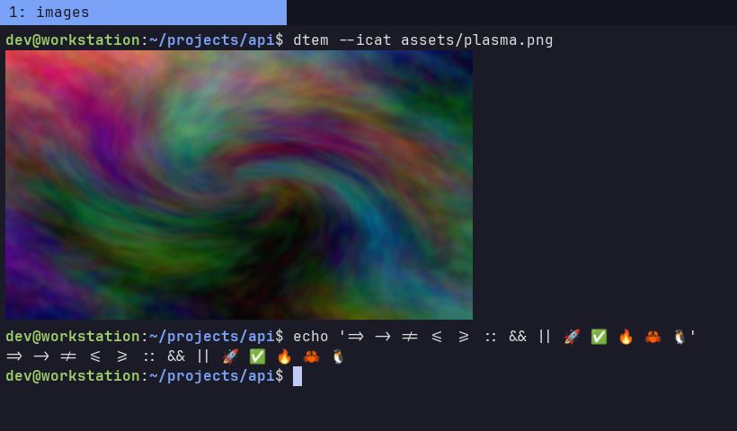
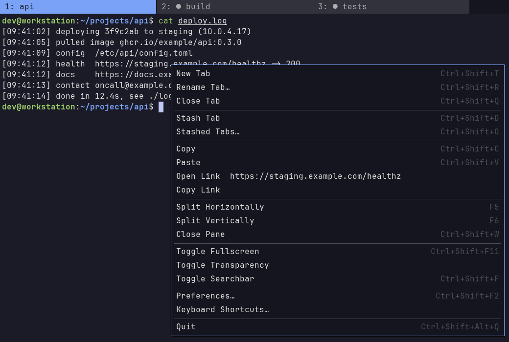
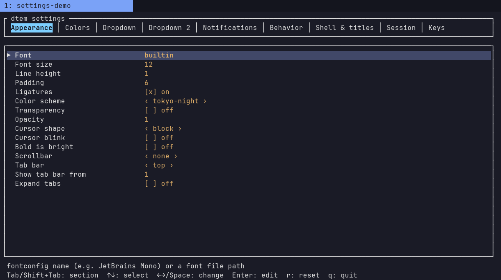
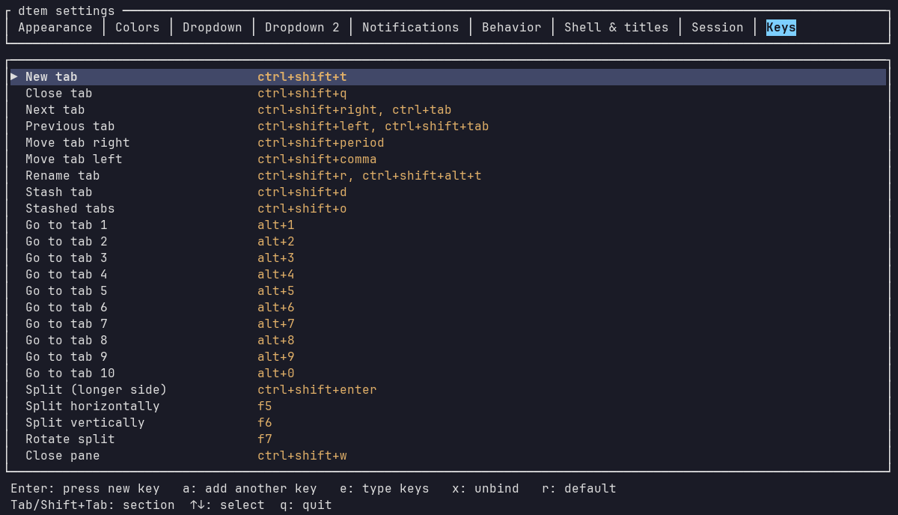

# dtem

**A GPU-accelerated terminal for Linux that never loses your work.** Use it as a normal window or as a dropdown terminal bound to a hotkey. Tabs, splits, scrollback and working directories survive restarts and reboots.



- **Fast:** renders through wgpu (Vulkan/GL) on top of `alacritty_terminal`.
- **Tabs and split panes:** a kitty-style split tree. Drag tabs to reorder them.
- **Tab stash:** put tabs away and bring them back later. Their output stays browsable in the meantime.
- **Session persistence:** windows, tabs, splits, cwd and scrollback are restored, even after a reboot.
- **Dropdown mode:** tilda/guake-style, remembers its monitor, and can import your tilda config.
- **Shell integration:** prompt jumping, fuzzy history search across tabs, and autosuggestions.
- **Kitty-compatible:** keyboard protocol, graphics protocol, OSC 8 hyperlinks and OSC 52 clipboard.
- **`dtem --remote`:** SSH with clipboard, image and file sync, so you can paste a screenshot into a remote Claude Code.
- **Single binary:** no runtime dependencies on x86_64 or arm64 Linux with glibc ≥ 2.30. Fonts and ble.sh are built in.

## Feature tour

### Tabs, splits and activity markers

Tabs and split panes are shown in the screenshot above. `kitty_mod+enter` splits along the longer side, and `F5`/`F6` split horizontally/vertically. You can resize, move and zoom panes from the keyboard.

To reorder tabs, **drag them** in the tab bar or use `kitty_mod+.`/`kitty_mod+,`.

Tabs you aren't looking at get a marker:
- **●** new output
- **🔔** a bell, for example an agent waiting for input
- **✗** a command failed

Long-running commands that finish in the background send a desktop notification. Click it to jump to the tab.

To rename a tab, **double-click** it, press `kitty_mod+r`, or right-click → Rename Tab….

### Stash tabs

Put a tab away with `kitty_mod+d` (or right-click → Stash Tab) and get it back later. A stashed tab keeps:
- its split layout and working directories,
- its scrollback,
- its per-tab command history,
- its title.

`kitty_mod+o`, or the **≡ N stashed** button at the end of the tab bar, opens the stash browser. It shows every pane's output **without restoring the tab**.

| In the browser | |
|---|---|
| ↑/↓ | select |
| Enter or double-click | restore the tab |
| `d` twice | delete it |
| Esc | close the browser |

Notes:
- Like session restore, stashing ends running programs; restored panes come back as shells.
- The stash is shared by all dtem windows and dropdowns, so you can stash a tab in the dropdown and restore it in a window.
- Stashed tabs survive restarts.



### Session persistence

The session is saved every 5 s, on exit and on SIGTERM/SIGHUP. On the next start you get back:
- every window and tab,
- the split layout and ratios,
- each pane's working directory,
- the **scrollback**, including the primary screen behind vim or htop,
- window size, position and monitor.

Running programs are not restarted: a pane that was running nvim comes back as a shell in the same directory. SSH tabs remember the remote directory and ask before reconnecting.

### Keyboard hints

`kitty_mod+e` puts a letter on every URL, path, IP address, git hash and e-mail address on screen. Press the letter to open or copy the item, or Shift+letter to type it into the terminal.



### Fuzzy history search and autosuggestions

**Ctrl+R** at a shell prompt opens dtem's own fuzzy history search over **all tabs**. Press Ctrl+R again to search only **this tab**. Enter puts the command on the prompt without running it. When vim, less, ssh or another program is in the foreground, Ctrl+R goes to that program instead.

Every tab keeps its own command history across restarts.



With bash, the bundled [ble.sh](https://github.com/akinomyoga/ble.sh) adds suggestions from your history as you type (→ accepts) and syntax highlighting:



### Search in scrollback

`kitty_mod+f` searches the scrollback and highlights every match.



### Images, ligatures and emoji

dtem implements the **kitty graphics protocol**. Images scroll with the text and stay in the scrollback. Use them with:
- `dtem --icat file.png`,
- `dtem-icat` on remote hosts,
- yazi, chafa, timg and other tools that support the protocol.

Text rendering supports programming **ligatures** (swash shaping) and **color emoji**.



### Right-click menu

Right-clicking a terminal or the tab bar opens a menu with New Tab, Rename Tab…, Close Tab, Stash Tab, Stashed Tabs…, Copy, Paste, Open/Copy Link, splits, fullscreen, transparency, search, Preferences…, Keyboard Shortcuts… and Quit. Each item shows its current shortcut. If a program uses the mouse (vim, htop), open the menu with **Shift+right-click**.



### Settings page and shortcut editor

Open the settings page with `ctrl+,`, `kitty_mod+F2`, right-click → Preferences…, or `dtem --settings`.

- All options are grouped there: appearance, colors, dropdown, notifications, behavior, shell & titles and session.
- Changes are written to `dtem.toml` with your comments preserved. Running instances apply them live.



The **Keys** section is a shortcut editor. Open it with right-click → Keyboard Shortcuts… or `dtem --settings=keys`.

| Key | Action |
|---|---|
| Enter | select an action, then press the new key combination |
| `a` | add a second combination |
| `e` | type the combination as text |
| `x` | unbind the action |
| `r` | restore the default |

If a combination is already used by another action, it is moved to the new one and the editor tells you. Key bindings fall back to the physical key position, so they also work on non-US layouts such as Turkish Q and F.



### More

- **Links:** Ctrl+click opens URLs and OSC 8 hyperlinks. They are underlined while Ctrl is held.
- **Input:** IME support (ibus/fcitx) and the kitty keyboard protocol, which nvim and similar apps can turn on.
- **Transparency:** background opacity is configurable (needs a compositor).
- **Close confirmations:** dtem asks before closing a tab, pane or window. You can turn this off.
- **Multiple dropdowns:** each has its own hotkey, tabs and session.

## Install

Download the binary or the .deb from the [Releases page](https://github.com/myprgit/dtem/releases). dtem is a single self-contained binary. JetBrains Mono, ble.sh, the shell integration and the notification client are all built in. It runs on any x86_64 or arm64 Linux desktop with glibc ≥ 2.30 (Ubuntu 20.04+, Debian 11+, Fedora 32+, …). Neither Rust nor this repository is needed on the target machine.

```bash
# single binary
chmod +x dtem-0.2.0-x86_64 && ./dtem-0.2.0-x86_64 --install
# or the Debian/Ubuntu package
sudo apt install ./dtem_0.2.0-1_amd64.deb && dtem --install
```

`dtem --install` sets up the following for the current user:
- the binary in `~/.local/bin` (unless it came from the .deb),
- a menu entry,
- the dropdown at login,
- the GNOME hotkeys,
- the shell integration and ble.sh.

`dtem --uninstall [--purge]` removes them again.

Take your settings along:

```bash
dtem --export-config            # → dtem-config.tar.gz (dtem.toml, saved layouts, ~/.blerc)
dtem --import-config dtem-config.tar.gz   # on the other PC (old config is backed up)
```

### Build from source

You need a recent stable Rust toolchain (edition 2024, Rust ≥ 1.85).

```bash
cargo build --release
./target/release/dtem --install     # or simply: ./install.sh
```

To build the release artifacts, run `scripts/build-dist.sh`. It writes `dist/` with:
- portable binaries for x86_64 and aarch64 (glibc ≥ 2.30),
- both .deb packages,
- `SHA256SUMS`.

It needs cargo-zigbuild, zig and cargo-deb.

## Coming from tilda

```
dtem --import-tilda              # reads ~/.config/tilda/config_0 (or pass a file)
```

The importer converts every tilda option: hotkey, size/position/centering, monitor, slide animation, auto-hide, the unfocused-hotkey behaviour, always-on-top, sticky, taskbar, transparency, colors and palette, cursor, bold-is-bright, bell, scrollback, word chars, backspace/delete codes, command/login shell/working dir, title options, tab bar options, link matching, confirmations, and all key bindings. Your previous config is backed up first. A few options have no counterpart in dtem (tooltips, notebook border, set-as-desktop); the importer lists them.

## Notifications and tab markers

- Tabs you aren't looking at get a marker: **●** new output, **🔔** bell, **✗** a command failed.
- Desktop notifications (click one to jump to the tab) are sent when:
  - a command that ran ≥ 10 s finishes while you aren't looking (`notify_command_seconds`),
  - a bell rings in a background tab — e.g. an agent waiting for input (`notify_on_bell`),
  - a program sends OSC 9 / OSC 777 (`notify_programs`).
- When a shell exits by itself (`exit`, Ctrl+D), dtem asks: Enter closes the pane, `r` restarts the shell and Esc keeps the pane open (`confirm_close.on_exit`).

## Shell integration

bash, zsh and fish are started with a small integration script. Your own `.bashrc`/`.zshrc` are loaded as usual; dtem only adds prompt marks (OSC 133) and cwd reports (OSC 7). It's turned off with `shell_integration = false`. With it:

| | |
|---|---|
| `kitty_mod+z` / `kitty_mod+x` | jump to the previous / next prompt |
| `kitty_mod+g` | copy the last command's output |
| long-running command notifications | see above |
| ssh tabs | the remote directory is remembered; after a restart, reconnecting opens there |
| separate history | every tab has its own command history (Up arrow), kept across restarts; new tabs start from `~/.bash_history` (`separate_history`) |
| suggestions while typing | bash: the bundled [ble.sh](https://github.com/akinomyoga/ble.sh) is unpacked to `~/.local/share/dtem/blesh` on first use; a ble.sh you installed yourself in `~/.local/share/blesh` takes precedence (dim suggestion, → accepts, Tab shows candidates, syntax colors); `autosuggestions = false` turns it off |

On hosts opened with `dtem --remote`, the integration, `dtem-copy` and `dtem-icat` are installed into `~/.local` automatically.

## Second dropdown

```toml
[dropdowns.2]
hotkey = "shift+F1"
height = 0.6
color_scheme = "dracula"
```

Each dropdown has its own tabs, session, monitor memory and settings; they appear on the settings page as **Dropdown** and **Dropdown 2**. `dtem --toggle=2` toggles it, and `dtem --install-gnome-shortcut` registers the hotkeys of all dropdowns.

## Usage

```
dtem                          normal window (restores the last session)
dtem --dropdown [--hidden]    dropdown terminal
dtem --toggle                 show/hide dropdown (bind this to a key)
dtem --session FILE.json      open a layout file
dtem --remote [ssh args] HOST ssh in a new tab with clipboard/file sync
dtem --no-restore             start fresh
dtem --install-gnome-shortcut register the dropdown hotkey in GNOME
dtem --quit [--dropdown] [--no-save]  quit (--no-save: forget the session)
dtem --settings               settings page
dtem --import-tilda [FILE]    import a tilda config
dtem --icat FILE              show an image in the terminal
```

## Remote (SSH) and clipboard sync

```
dtem --remote user@host
dtem --remote -p 2222 -i ~/.ssh/key user@host     # any ssh options
```

Typed inside a dtem terminal, it runs ssh **right in that pane** (like `kitten ssh`); use `--new-tab` to open it in a new tab instead. Started from elsewhere, it opens a tab in the running dtem. The session is multiplexed through an SSH ControlMaster, so file transfers reuse the same authenticated connection and never ask for a password again.

| What | How |
|---|---|
| Local image → remote | Copy an image (e.g. a screenshot) and press `kitty_mod+v` in the ssh pane. It works like herdr: the image is staged in a private temp dir on the server (`/tmp/dtem-clipboard-<uid>/`, mode 0600, removed after 24 h) and its bare path is pasted. Agents such as Claude Code attach it as an image. |
| Local files → remote | Copy files in the file manager and paste, or drag & drop them onto the pane. They are uploaded and their paths are typed. |
| Remote text → local clipboard | `echo hi \| dtem-copy`, or any program using OSC 52 (nvim, tmux with `set-clipboard on`). |
| Remote image/file → local clipboard | `dtem-copy shot.png`. Images go on your clipboard as images. Other files are saved to `~/Downloads/dtem/` and copied as files. |
| Remote programs reading your clipboard (OSC 52) | Asks first: allow once / always / deny (`clipboard_read`). |

- **Helper install:** `dtem-copy` is installed into `~/.local/bin` on the server on first connect. Turn this off with `remote_install_helpers = false`.
- **Manually started ssh:** if you start `ssh host` yourself inside a local pane, image/file paste still works through a separate `ssh -o BatchMode=yes` connection. That connection needs key or agent authentication.
- **Disconnect:** the pane offers to reconnect.
- **After restore:** remote tabs come back with their scrollback and ask before reconnecting. Programs are never restarted.
- **Local panes:** pasting an image stages it the same way in a local temp dir and pastes the path.

## Dropdown and monitors

- Under X11, the hotkey (default `F12`; several keys allowed, e.g. `["F1", "ctrl+alt+t"]`) is grabbed globally. Keys that already have a GNOME shortcut are not grabbed a second time. Under GNOME, both X11 and Wayland, run `dtem --install-gnome-shortcut` instead. It registers `dtem --toggle` as a custom shortcut.
- The dropdown always appears on the monitor you last moved it to. To move it, either:
  - use `kitty_mod+alt+m` (next monitor), or
  - use GNOME's `Super+Shift+←/→`.
- The chosen monitor, and whether the dropdown was fullscreen when last hidden, are stored in the session, so they survive reboot. If that monitor is unplugged, the dropdown falls back to the primary monitor.
- When the hotkey is pressed while the dropdown is visible but unfocused, it is focused. If it is already focused, it is hidden.

## Wayland

- Normal windows run natively on Wayland. Size and maximized state are restored. Wayland does not let apps set their own window position; set `force_x11 = true` to get position restore through XWayland.
- On Wayland the dropdown runs through XWayland. GNOME has no layer-shell, so absolute positioning and per-monitor placement only work this way. Guake does the same.
- The clipboard uses the native Wayland or X11 clipboard, including the primary selection.

## Shortcuts (`kitty_mod` = ctrl+shift)

| Action | Key |
|---|---|
| new tab (inherits cwd) / close tab | `kitty_mod+t` / `kitty_mod+q` |
| next / previous tab | `kitty_mod+→` `ctrl+tab` / `kitty_mod+←` `ctrl+shift+tab` |
| go to tab N | `alt+1..9` |
| move tab | `kitty_mod+.` / `kitty_mod+,`, or drag it in the tab bar |
| rename tab | `kitty_mod+r`, `kitty_mod+alt+t`, or double-click the tab |
| stash tab / stashed tabs | `kitty_mod+d` / `kitty_mod+o` |
| new split (along the longer side) | `kitty_mod+enter` |
| hsplit / vsplit / rotate split | `F5` / `F6` / `F7` |
| close pane | `kitty_mod+w` |
| next / previous pane | `kitty_mod+]` / `kitty_mod+[` |
| pane N | `kitty_mod+1..9` |
| focus neighbour | `kitty_mod+alt+h/j/k/l` |
| resize pane | `kitty_mod+alt+arrows` |
| move pane | `kitty_mod+alt+f` / `kitty_mod+alt+b` |
| zoom pane | `kitty_mod+l` |
| copy / paste / paste selection | `kitty_mod+c` / `kitty_mod+v` / `shift+insert` |
| open URL | `ctrl+click` |
| scroll | `kitty_mod+↑/↓/k/j`, `shift+pgup/pgdn`, `kitty_mod+home/end` |
| clear scrollback | `kitty_mod+delete` |
| font size | `kitty_mod+=` / `kitty_mod+-` / `kitty_mod+backspace`, or **Ctrl+mouse wheel** |
| new OS window | `kitty_mod+n` |
| fullscreen | `kitty_mod+f11` |
| export layout to `~/.config/dtem/sessions/` | `kitty_mod+alt+s` |
| search in scrollback | `kitty_mod+f` |
| settings page | `kitty_mod+f2`, `ctrl+,` |
| quit (asks; `d` = quit without saving) | `kitty_mod+alt+q` |
| transparency on/off | `toggle_transparency` (unbound by default) |
| reload config | `kitty_mod+f5` |
| dropdown → next monitor | `kitty_mod+alt+m` |

Key bindings match on the physical key position as a fallback, so they also work on Turkish Q and F layouts.

## Session / layout files

These are plain JSON, in the same format as the autosave. Example:

```json
{"windows":[{"tabs":[
  {"title":"api","layout":{"Split":{"vertical":true,"ratio":0.6,
    "a":{"Leaf":{"cwd":"~/proj/api","command":"nvim ."}},
    "b":{"Leaf":{"cwd":"~/proj/api","command":"ssh devbox"}}}}},
  {"title":"logs","layout":{"Leaf":{"cwd":"/var/log"}}}
]}]}
```

`command` runs once and then drops you into a shell in that pane. Autosaved sessions never re-run commands.

Files:
- config: `~/.config/dtem/dtem.toml` (see `dtem.example.toml`)
- state: `~/.local/state/dtem/`

## Third-party components

- [alacritty_terminal](https://github.com/alacritty/alacritty) handles terminal emulation (Apache-2.0).
- [JetBrains Mono](https://www.jetbrains.com/lp/mono/) is bundled as the built-in font (SIL OFL 1.1, see `assets/fonts/JetBrainsMono-OFL.txt`).
- [ble.sh](https://github.com/akinomyoga/ble.sh) is bundled for bash autosuggestions (BSD-3-Clause, see `packaging/blesh-LICENSE.md`).

## License

dtem is licensed under the [Apache License 2.0](LICENSE). You may use, modify and redistribute it, commercially too. Redistributions must keep the copyright notice, the license and the [NOTICE](NOTICE) file, and modified files must say that they were changed. The license grants no right to use the dtem name to suggest endorsement (section 6).

